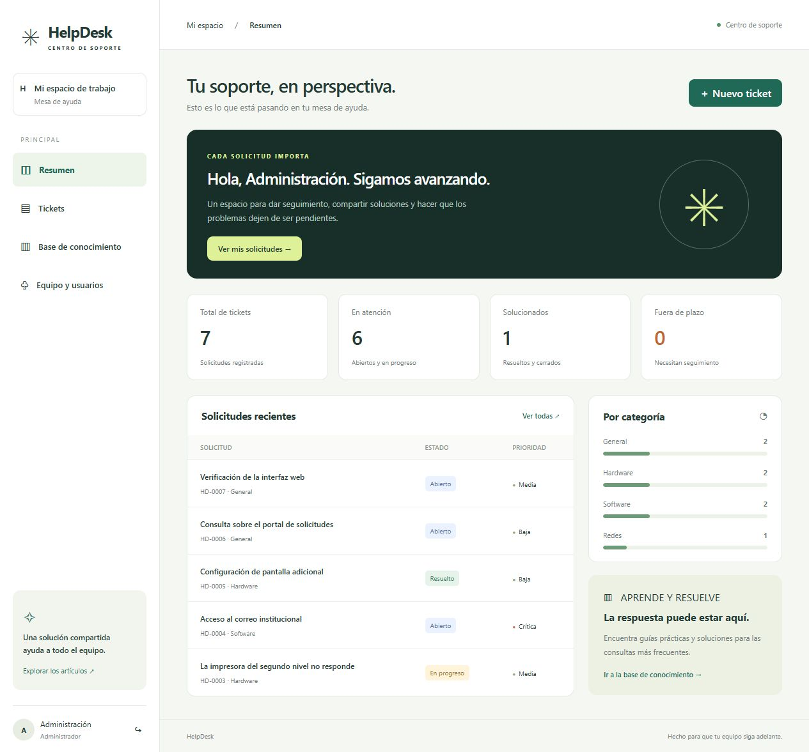

# HelpDesk · Centro de soporte

Mesa de ayuda desarrollada en **Python + FastAPI + SQLAlchemy**, con base de datos **SQLite** e interfaz en HTML, CSS y JavaScript. Continúa la estructura original del proyecto y completa su ejecución, interfaz y pruebas.



## Ejecutar en Windows

Requiere Python 3.11 o superior (validado con Python 3.13).

```powershell
git clone --branch rama-2 https://github.com/Jescr10/HelpDesk_Proyecto.git
cd HelpDesk_Proyecto
python -m venv .venv
.\.venv\Scripts\python -m pip install -r requirements.lock.txt
.\.venv\Scripts\python -m app.scripts.seed
.\.venv\Scripts\python -m uvicorn app.webs.main:app --reload
```

Abre **http://127.0.0.1:8000**. La documentación interactiva de la API está en **http://127.0.0.1:8000/docs**.
En Linux/macOS utiliza `.venv/bin/python` en lugar de `.\.venv\Scripts\python`.

### Cuentas de demostración

`seed` crea usuarios y contenido ficticio únicamente si todavía no existen usuarios. No reemplaza datos existentes ni se ejecuta al iniciar el servidor.

| Correo | Rol |
| --- | --- |
| admin@example.com | Administrador |
| supervisor@example.com | Supervisor |
| technician@example.com | Técnico |
| requester@example.com | Solicitante |

Contraseña de las cuatro cuentas de demostración: **`HelpDeskDemo2026!`**. Estas cuentas son solo para presentación local.

Para una base sin datos de ejemplo, omite `seed` y ejecuta:

```powershell
.\.venv\Scripts\python -m app.scripts.create_admin
```

## Funciones

- Inicio de sesión con contraseñas cifradas mediante hash PBKDF2 y tokens JWT con vencimiento.
- Panel con indicadores reales: solicitudes, atención pendiente, solucionados y vencidos.
- Creación y edición de tickets, búsqueda, filtros por estado y prioridad.
- Asignación a técnicos/supervisores, comentarios y registro de actividad.
- Flujo controlado de estados, cancelación y cierre posterior a resolución.
- Objetivos de atención de 4, 24, 48 y 72 horas según prioridad.
- Base de conocimiento con búsqueda, creación, edición y eliminación por rol.
- Creación de usuarios por administradores y listado de equipo para supervisores.
- Diseño adaptable a escritorio y móvil, formularios etiquetados y mensajes de error.

## Roles

| Operación | Solicitante | Técnico | Supervisor | Administrador |
| --- | --- | --- | --- | --- |
| Crear tickets | Sí | Sí | Sí | Sí |
| Ver tickets/comentar | Propios | Todos | Todos | Todos |
| Editar tickets | Propios abiertos | No finalizados | No finalizados | No finalizados |
| Asignar/cambiar estado | No | Sí | Sí | Sí |
| Cancelar | Propios activos | Activos | Activos | Activos |
| Leer artículos | Sí | Sí | Sí | Sí |
| Crear/editar artículos | No | Sí | Sí | Sí |
| Eliminar artículos | No | No | Sí | Sí |
| Consultar usuarios | No | No | Sí | Sí |
| Crear usuarios | No | No | No | Sí |

Los artículos también son consultables sin sesión mediante la API. No deben contener información privada. Los roles se verifican en el servidor, independientemente de lo que muestre la interfaz.

## Estructura

```text
app/
  api/           Endpoints REST
  core/          Configuración, seguridad y conexión a la base
  models/        Entidades SQLAlchemy y vocabulario
  repositories/  Consultas de persistencia
  schemas/       Validación de entradas
  services/      Reglas de negocio
  scripts/       Carga de demostración y creación de administrador
  webs/          Aplicación FastAPI y archivos de interfaz
docs/            Esquema, decisiones y manual de operación
tests/           Pruebas de integración con SQLite aislado
```

## Base de datos y configuración

Se crea `helpdesk.db` automáticamente en la carpeta desde la que ejecutas el proyecto. Contiene usuarios, tickets, comentarios, historial y artículos, con claves foráneas activadas. No se versiona la base: cada instalación genera la suya.

Puedes copiar `.env.example` a `.env` y configurar `DATABASE_URL`, `JWT_SECRET` y `JWT_EXPIRE_HOURS`. Genera una clave privada con `python -c "import secrets; print(secrets.token_hex(32))"`. Sin clave configurada se genera una temporal: reiniciar invalida las sesiones. No publiques `.env`.

Consulta [esquema de datos](docs/database/README.md), [decisiones de arquitectura](docs/decisions/001-arquitectura.md) y [manual de operación](docs/operacion/README.md).

## Verificación

```powershell
.\.venv\Scripts\python -m pytest -q
```

La suite cubre autenticación, aislamiento entre solicitantes, roles, validaciones, ciclo de ticket, historial, artículos, usuarios duplicados y persistencia entre instancias. GitHub Actions ejecuta las pruebas en cada push y pull request.

## Alcance

Versión funcional para desarrollo y demostración académica. No incluye correo saliente, archivos adjuntos, recuperación de contraseñas ni autenticación de dos factores. Los plazos son horas corridas y se calculan desde la creación; cambiar prioridad recalcula el plazo. No hay migraciones automáticas para cambios de esquema sobre una base existente. Para publicar en internet se requiere configurar alojamiento Python, HTTPS, clave privada persistente, copias de seguridad y protección de intentos de acceso. Subir a GitHub no pone el servidor web en línea.
