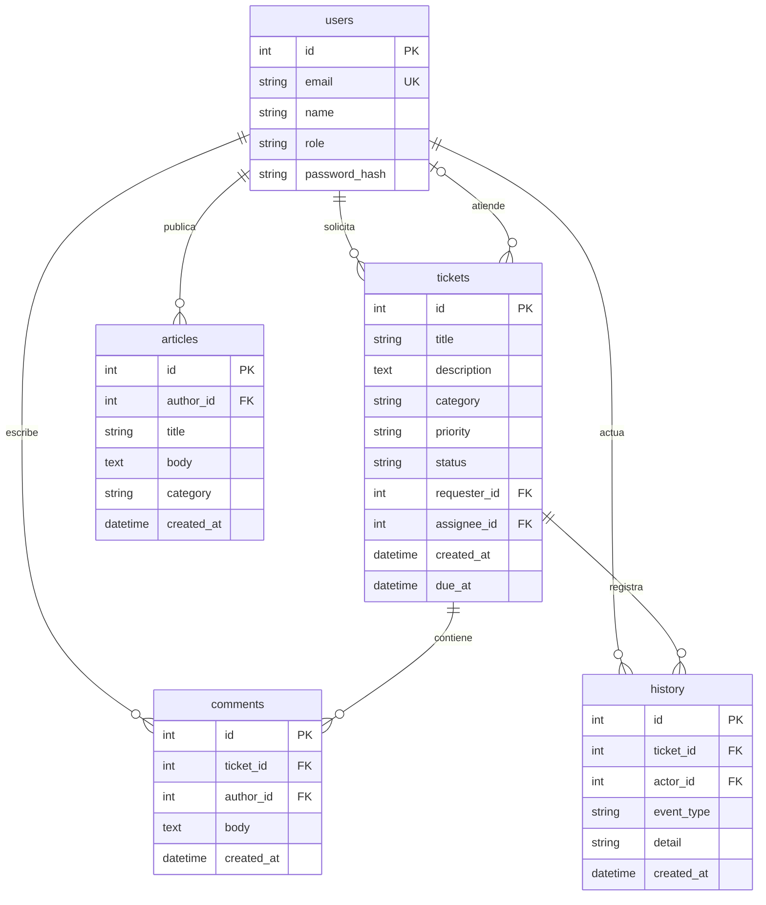

# Modelo de datos

SQLite se crea desde los modelos SQLAlchemy. Las fechas se guardan como UTC sin zona para compatibilidad con SQLite; el navegador las presenta en la zona local.

Las operaciones sobre tickets guardan el cambio y su evento en una misma transacción. Los solicitantes no pueden leer ni modificar tickets ajenos. Las contraseñas nunca se devuelven en respuestas API.

## Estados

- Abierto → En progreso o Cancelado.
- En progreso → Abierto, Resuelto o Cancelado.
- Resuelto → En progreso o Cerrado.
- Cerrado y Cancelado son finales; no se pueden editar sus datos.
- Se permiten comentarios posteriores al cierre para conservar información adicional.

Resuelto, Cerrado y Cancelado no se cuentan como pendientes ni vencidos. Un responsable debe ser técnico o supervisor.

## Evolución

`create_all` crea tablas faltantes, pero no migra columnas de una base existente. Antes de cambiar modelos persistentes, realiza una copia e incorpora migraciones versionadas (por ejemplo, Alembic). No borres una base con datos reales para aplicar un cambio de esquema.
